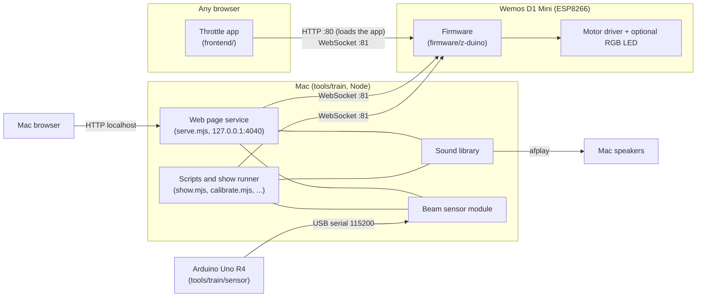

# Architecture: what runs where

Z-Duino began as one thing: firmware on a Wemos D1 Mini that serves a Vue throttle app and takes commands over a WebSocket. It has since grown a second half that runs on a Mac (`tools/train`): a beam sensor, a sound library, show automation and a web page for running shows. This page says which code runs on which machine, how the pieces talk, who is allowed to do what, and where each setting lives.

## The pieces

| Code | Runs on | Talks to | Owns |
|---|---|---|---|
| `firmware/z-duino/`, `lib/` (MotorLogic, LedTiming, Command) | Wemos D1 Mini. `lib/` is also compiled natively for `pio test -e native`. | Serves HTTP :80 and WebSocket :81; mDNS name from `MDNS_HOSTNAME` (default `ztrain.local`) | Current speed and direction, the invert flag (RAM only, forgotten on reboot), the connected-client count. **The only code that drives the motor and the (optional) status LED.** Which optional hardware a controller was built with (`HAS_STATUS_LED`) is reported in its status message as `features`, and the throttle app and the Mac tools adapt to it. Persists nothing; LittleFS holds only the built frontend. |
| `frontend/` | Built by Vite into `build/data/`, flashed to LittleFS, runs in a phone or desktop browser. `npm run dev:all` runs it on the Mac against `mock-server.ts`. | WebSocket :81 on the host it was loaded from | Client-side speed ramping; the invert choice (browser `localStorage`, re-sent on every connect); party-mode beat engine. |
| `tools/train/sensor/` | Arduino Uno R4 Minima | USB serial to the Mac | Nothing: streams `reading,microseconds` at about 50 Hz. |
| `tools/train/lib/` modules and the scripts around them (`show.mjs`, `serve.mjs`, `calibrate.mjs`, `measure-zones.mjs`, ...) | Mac, Node 22+, zero dependencies | WebSocket :81 as a client of the Wemos; serial from the Uno; `afplay` for sound; HTTP on `127.0.0.1` for the web page | Show runs, sensor state, sound playback; your files in `tools/train/local/` (calibration, loco profile, layout, shows, settings). |
| `build.sh`, `platformio.ini`, `secrets.ini` | Mac build tooling | USB flash to the Wemos | Build-time firmware configuration. |

The Wemos has no idea the Mac exists: a Mac script is just another WebSocket client speaking the protocol in [PROTOCOL.md](PROTOCOL.md), exactly like the browser.

## Authority and safety

- **The Wemos trusts every client.** Any number of clients can connect at once and there is no ownership or lock, so a browser and a Mac show can fight over the throttle. Treat the track as one-controller-at-a-time by convention.
- **Motor care is enforced by the clients, not the firmware.** The firmware applies whatever speed it receives; its only protection is the 30 s safety timeout (it stops the motor if no message arrives for 30 s) and the build-time PWM limits.
  - `frontend/`: ramps speed changes (about 1 s per 0.1 of throttle) and pauses on direction changes.
  - `tools/train/lib/controller`: ramps the same way, refuses abrupt stops and reversals above creep speed (`MotorCareError`), and only allows a move without a ramp when a beam event guards it (`guardedMove`). Show runs and the web page go through it.
  - The older standalone scripts in `tools/train` carry their own ramps (being replaced; see below).
- **Keepalive.** Every client must keep talking: the Mac controller module pings every 5 s, the browser every 10 s. The firmware's limit is 30 s.
- **The Mac web page** (`serve.mjs`) only listens on `127.0.0.1`, checks the Host header, accepts JSON posts only, runs one show at a time, and has STOP (ramps down) and E-STOP (the controller's `stop` command) always available.

## State and where it lives

| State | Lives in | Notes |
|---|---|---|
| Speed, direction | Wemos RAM | Lost on reboot; the motor is stopped at boot. |
| Invert (motor polarity) | Wemos RAM, set by `{cmd:"invert"}` | The browser re-sends its saved choice on connect. The Mac tools send `controller.invert` from their settings if you set it. The firmware has one flag, so **whichever client connected last wins**. |
| WiFi, hostname, railroad name, PWM limits | `secrets.ini`, compiled into the firmware | Changing them means re-flashing. |
| Beam calibration, loco profile, layout, shows, results, traces, your settings | `tools/train/local/` (git-ignored) | Copy the folder to move a setup. `TRAIN_LOCAL` points the tools at another folder. |
| Sound packs | `tools/train/packs/` (manifests, committed) and the audio files they name (generated or imported by you, not committed) | The `sound.packs` setting chooses which load. |

## Configuration

Two separate worlds, on purpose:

- **Firmware and build** (`secrets.ini`, `platformio.ini`): what the Wemos is compiled with. PlatformIO needs these at build time. See [BUILD.md](BUILD.md).
- **The Mac tools** (`tools/train`): defaults in code (`tools/train/lib/config/index.mjs`), overridden by `tools/train/local/config.jsonc`, then environment variables, then command-line flags. Start from `tools/train/config.example.jsonc`, which documents every setting and is generated from the same table the code reads. `node config.mjs` prints what is in effect and where each value came from.

| Setting | Key | Env | Flag | Default |
|---|---|---|---|---|
| Controller address | `controller.host` | `TRAIN_HOST` | `--host=` | resolves `ztrain.local` |
| Controller port, keepalive | `controller.port`, `controller.pingMs` | | | 81, 5000 ms |
| Motor invert on connect | `controller.invert` | | `--invert=` | not sent |
| Sensor serial port | `sensor.port` | `SENSOR_PORT` | `--sensor-port=` | the only `/dev/cu.usbmodem*` |
| Sensor baud | `sensor.baud` | | | 115200 (match the sketch) |
| Web page port | `web.port` | | `--port=` | 4040 |
| Sound volume, engine, packs | `sound.volume`, `sound.engine`, `sound.packs` | | `--volume=`, `--engine=`, `--packs=` | 0.5, `afplay`, synth + jr-east |

Not settings, but data about your track, kept as files in `local/`: beam levels (`sensor_levels.json`; `BEAM_CLEAR` and `BEAM_BLOCKED` override them), loco profile, layout, shows.

## Running things

| What | Command | Needs |
|---|---|---|
| Firmware and frontend | `./build.sh` (see [BUILD.md](BUILD.md)) | PlatformIO, Node, `secrets.ini`, the Wemos on USB |
| Firmware unit tests | `pio test -e native` | PlatformIO |
| Frontend dev and tests | `cd frontend && npm run dev:all`, `npm test` | Node |
| Mac tools tests | `cd tools/train && node --test --test-timeout=30000 test/*.test.mjs` | Node 22+ |
| Web page | `cd tools/train && node serve.mjs --open` (`--no-sensor` for no hardware) | the sensor's serial port while it runs |
| A show | `node show.mjs sim <show>` (no hardware), `node show.mjs run <show>` | the train, the sensor |

Only one program at a time can hold the sensor's serial port: stop `serve.mjs` before `calibrate.mjs`, `measure-zones.mjs` and friends.

## Inside tools/train

- **Modules** (`lib/`): `sensor` (events from the beam, calibration), `sound` (library, packs, engines), `controller` (WebSocket client with the motor-care rules), `show` (the `z-show/1` JSON runtime, layout zones, simulator), `web` (the page's service), `config` (settings), `paths` (the `local/` folder). Each takes its dependencies as arguments, so everything is tested without hardware.
- **Scripts** (top level): thin command-line front ends over the modules (`show.mjs`, `serve.mjs`, `calibrate.mjs`, `creep-stop.mjs`, `measure-zones.mjs`, `sound-test.mjs`, `sensor-watch.mjs`, `config.mjs`).
- **Older standalone scripts** (`signal-show`, `ramp-loops`, `learn-loco`, ...) predate the modules and still carry their own serial, WebSocket and threshold code. They are being replaced by example shows or moved onto the modules.
- The throttle app (`frontend/`) and the Mac web page share no code. The Mac page imitates the throttle app's look so the two read as one product.

## Open questions

- Two throttle surfaces (`frontend/` served by the Wemos, and the Mac page) overlap. They could stay separate, or the Mac page could eventually offer a manual throttle too.
- Should motor care move into the firmware (a maximum speed step, refusing to reverse while moving), so it no longer depends on every client behaving?
- Should the firmware gain a client lock or "who is driving" indicator?
